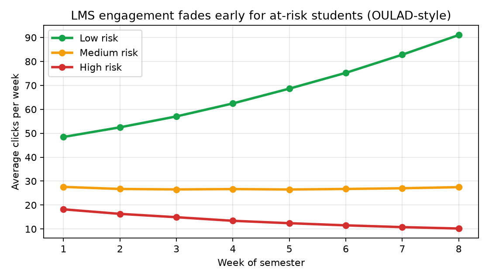
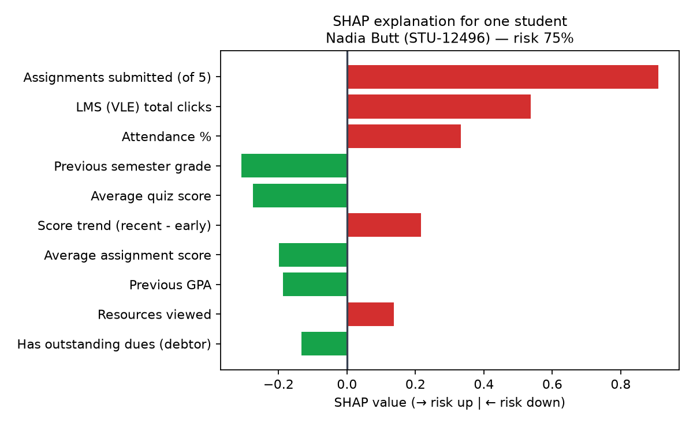
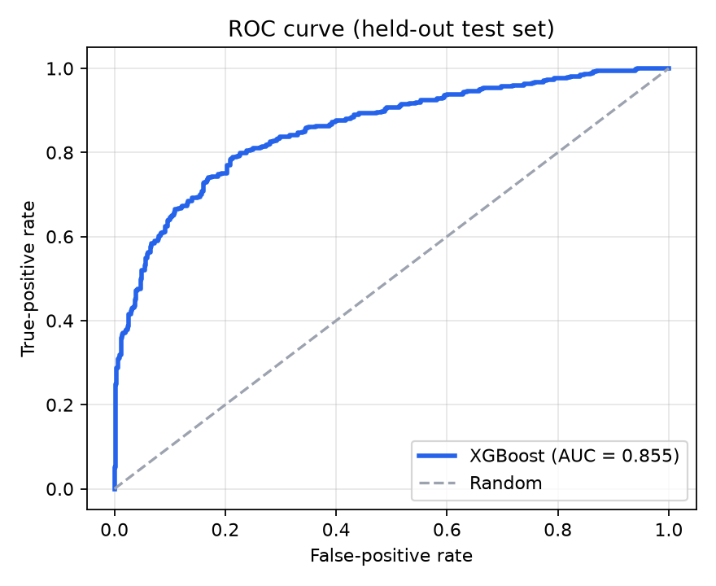
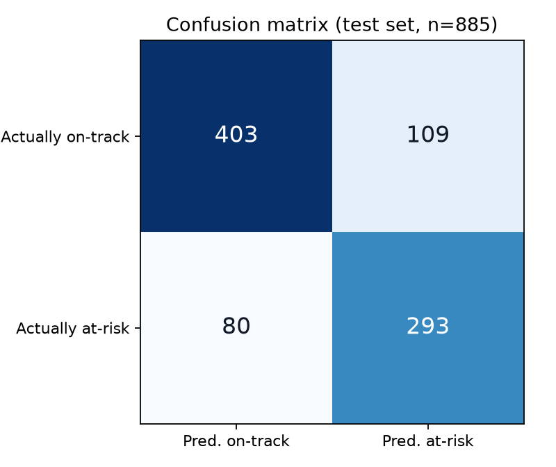
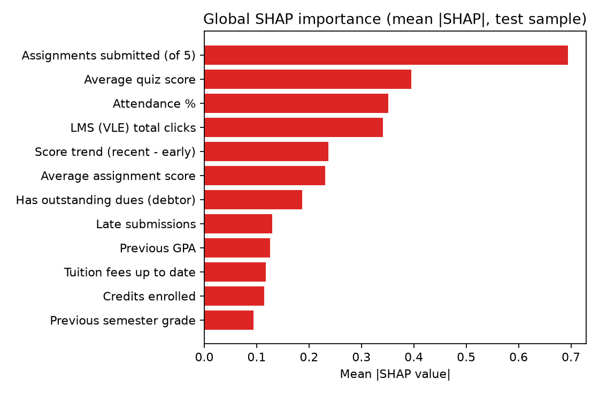
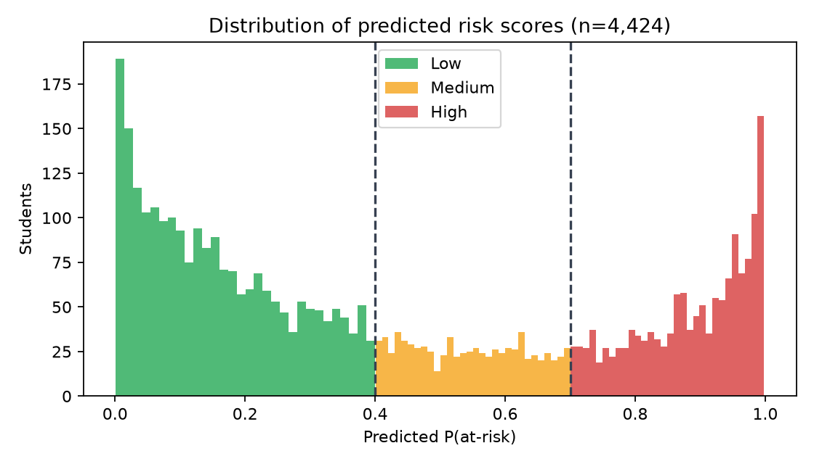

# 🎓 Student Early-Warning System
### OULAD (#99) + UCI Student Dropout (#100) — with SHAP explanations & what-if simulator
### 👑 Admin Panel · 👩‍🏫 Teacher Portal · 🎓 Student Portal (my record)

> Universities usually notice a struggling student only **after** they fail.
> This system flags at-risk students **by week 8 of the semester** — while there
> is still time to help — and, unlike a black-box score, it explains **why**
> each student was flagged and **what would change it**.



*The core OULAD insight: students who eventually fail/withdraw disengage from the LMS weeks earlier. That early signal is what this system exploits.*

---

## ⚡ Quick start

```bash
git clone <this-repo> && cd mrmtest
./run.sh                      # creates venv, installs deps, builds data+model, launches app
# …or manually:
pip install -r requirements.txt
python -m src.generate_data   # 1) combined OULAD+UCI-schema dataset (4,424 students)
python -m src.train_model     # 2) train XGBoost, compare models, score everyone, SHAP
python -m src.database        # 3) SQLite DB + Admin/Teacher/Student logins
streamlit run app.py          # 4) open http://localhost:8501
```

`docker build -t early-warning . && docker run -p 8501:8501 early-warning` also works.
First run without data/model? The app shows a **one-click bootstrap button** that builds everything.

## 🔐 Demo logins (also one-click buttons on the login screen)

| Role | Username | Password | What you get |
|---|---|---|---|
| 👑 **Admin** | `admin` | `admin123` | Whole institution, student/user management, Model Center (metrics, ROC, SHAP, retrain), all interventions |
| 👩‍🏫 **Teacher** | `sarah.ahmed` | `teacher123` | My cohort (CS101), at-risk priority queue, SHAP + what-if per student, log interventions |
| 👩‍🏫 Other teachers | `imran.khan`, `ayesha.malik`, `hassan.raza`, … | `teacher123` | Each teacher sees **their own** course cohort |
| 🎓 **Student (demo)** | `demo.student` | `student123` | **Iqra** — a high-risk student's own record, success score, action plan, teacher messages |
| 🎓 Any student | their ID e.g. `stu-10001` | `student123` | That student's own record (seeded sample; Admin can create more) |

## 🎬 5-minute demo script (for viva / presentation)

1. **Login as Teacher** (`sarah.ahmed`) → Dashboard: *"193 of my 585 students are high-risk today."*
2. **Student Explorer** → pick the top student → 🎯 **risk gauge + plain-English SHAP reasons**:
   *"Only 3 of 5 assignments submitted (+0.91) · Only 70 LMS clicks (+0.54) · Attendance 64% (+0.33) · Scores falling −14 pts (+0.22)"*
3. Scroll to the **what-if simulator**: preset cards show *"Submit everything on time: **75% → 28%**"* and
   *"Full action plan: **75% → 11%**"*. Drag sliders live.
4. **Log an intervention** (form is pre-filled from the top SHAP reason) → Save.
5. **Log out → one-click Student login** → **Messages from Teacher** — your intervention is already there.
   Student sees a supportive **Success Score**, *"Why my score?"* with advice, and their own what-if action plan.
6. **Login as Admin** → **Model Center**: accuracy/AUC/recall, confusion matrix, ROC, model comparison,
   global SHAP, and the **Retrain** button. → **Users & Teachers**: cohorts per teacher. → **Add Students**: add one
   (scored instantly + login auto-created) or batch-score an uploaded CSV.

---

## 🧩 What makes this more than "at-risk: yes/no"

### 1) SHAP explanations in plain English (`src/predict.py`)
Every prediction is explained per student with exact SHAP TreeExplainer values,
translated into sentences an advisor can say out loud:



> **Nadia (STU-12496, Physics) — risk 75%.** Her quiz average is actually *strong* (78%, pulling risk **down**),
> but she has submitted only 3 of 5 assignments, logged just 70 LMS clicks, attendance is 64% and her
> scores are falling. **A capable student quietly disengaging — precisely who early warning exists to catch**,
> and precisely who a marks-only system would miss until the final exam.

### 2) What-if simulator (counterfactuals, `what_if()` in `src/predict.py`)
Advisors/students drag sliders (quiz score, missing/late, LMS clicks, attendance, score trend…)
and the model re-scores instantly. For Nadia Butt: quiz +10 pts → **75%→64%** · submit everything on time → **75%→28%** ·
combined realistic plan → **75%→11%**. One lever alone is small (honest); combined behaviour change is the message of the advising meeting.

### 3) Closed intervention loop
Teacher logs help (meeting/email/tutoring/finance referral) → it appears instantly in the **Student portal**
and in **Admin oversight**, with status tracking (Open → In Progress → Resolved).

### 4) Fairness & framing by design
- `age` and `gender` exist in the source datasets but are **deliberately not model features** — a student must
  never be flagged because of who they are, only because of *changeable* behaviour/record. (Enforced by a unit test.)
- Students never see a scary "you will fail" label: they see a **Success Score (100 − risk%)**, supportive copy,
  and advice. Same model, humane presentation.
- Humans stay in the loop: the system * prioritises outreach*, it never auto-punishes, and students can see (and dispute) their own record.

---

## 👥 The three portals

### 👑 Admin Panel
Institution KPIs · risk by course · engagement-fade chart · top-risk list · **Students** (filter by course/teacher/risk,
search, full advisor inspection, CSV export) · **Add student** (instant scoring + optional login creation) ·
**Batch-score CSV** upload (with template) · **Users & Teachers** (create/deactivate/delete accounts, cohort load per teacher) ·
**Model Center** (comparison table, confusion matrix, ROC, global SHAP, one-click retrain) · **All Interventions** oversight.

### 👩‍🏫 Teacher / Advisor Portal
My-cohort dashboard · today's priority queue (highest risk first) · common warning-signs table ·
**Student Explorer** (gauge, SHAP reasons chart, week-by-week LMS activity vs class, assignment table,
what-if simulator, full record vs class average, intervention logger + history) · Class Analytics
(risk by course, engagement-vs-performance scatter) · My Interventions with status updates.

### 🎓 Student Portal — *"check my own record"*
My Dashboard (Success Score gauge, status message, headline metrics vs class, my weekly LMS chart) ·
**My Record & Activity** (profile, assignments, engagement vs class average, weekly table) ·
**Why My Score? + Action Plan** (friendly SHAP reasons with concrete advice, optional technical SHAP chart,
personal what-if sliders, commitment checklist) · **Messages from Teacher**.

---

## 🗄️ Data — OULAD (#99) + UCI Dropout (#100)

| | OULAD | UCI Student Dropout |
|---|---|---|
| Students | 32,593 (7 modules) | 4,424 |
| Signal | **Week-by-week VLE clicks**, assessments & scores | Academic, demographic & **financial** features |
| Target | Pass / Distinction / Fail / Withdrawn | Graduate / Enrolled / Dropout |
| What we take | clicks, active days, forum/resources, submission behaviour, scores, score trend | admission grade, prior GPA/grades, credits, scholarship, debtor, tuition status, first-generation |

The two datasets describe *different universities' students*, so they cannot be row-merged.
Like most combined #99+#100 projects, this repo therefore uses **one unified schema** taking the best
features of both, and ships a documented generator (`src/generate_data.py`, latent
ability/engagement/financial-stress factors → realistic correlated features, n = 4,424 mirroring UCI)
so the project runs anywhere with zero downloads. Everything downstream (training, SHAP, app) only
depends on the schema in `config.FEATURES`.

**Using the real files instead** (see also `docs/PROJECT_REPORT.md` §3.3):
- UCI: `pip install ucimlrepo`, then the built-in `download_uci()` hook in `src/generate_data.py` fetches it to `data/uci_real_raw.csv`.
- OULAD: download from analyse.kmi.open.ac.uk; aggregate `studentVle.csv` clicks to weeks 1–8 per student,
  join `studentAssessment.csv` (submitted/late/scores by week 8) and `studentInfo.csv` (final_result → at_risk),
  save as `data/students_raw.csv` with the `config.FEATURES` columns, then re-run `train_model` (or Admin → Retrain).

> ⚠️ **Leakage rule enforced throughout:** only information knowable by **week 8** is a model feature.
> End-of-semester outcomes are the *target*, never an input.

## 🤖 Model

XGBoost (deployed) vs Random Forest vs Logistic Regression — same stratified 80/20 split (`src/train_model.py`):

| Model | Accuracy | Precision | Recall | F1 | ROC-AUC |
|---|---|---|---|---|---|
| **XGBoost ⭐** | **78.6%** | 72.9% | **78.6%** | **0.756** | 0.855 |
| Random Forest | 78.6% | 73.6% | 76.9% | 0.752 | 0.859 |
| Logistic Regression | 77.0% | 70.3% | 78.6% | 0.742 | 0.857 |

All three are within ~0.004 AUC (i.e. tied); **XGBoost is deployed** because it supports *exact* SHAP
TreeExplainer explanations and captures threshold effects ("2+ missing assignments") that dominate
real OULAD data. On the test set it correctly flags **293** at-risk students and misses **80**
(false negatives — the costly error, which is why recall and the Low<40% ≤ Medium<70% ≤ High
bands matter more than raw accuracy here).

|  |  |
|---|---|
|  |  |

Global SHAP verdict: **assignments submitted, quiz score, attendance, LMS clicks and score trend**
drive risk — all things a student can change *this week*. That is exactly what an early-warning (not labelling) system needs.

## 🏗️ Project structure

```
mrmtest/
├── app.py                    # Streamlit entry: login + role routing (Admin/Teacher/Student)
├── config.py                 # FEATURES, labels, risk bands, teachers, paths (single source of truth)
├── requirements.txt  run.sh  Dockerfile
├── src/
│   ├── generate_data.py      # combined OULAD+UCI-schema dataset builder (+ real-UCI download hook)
│   ├── train_model.py        # XGBoost vs RF vs LR, metrics, global SHAP, scores every student
│   ├── predict.py            # ⭐ prediction + SHAP→plain-English engine + what_if() counterfactuals
│   ├── database.py           # SQLite: users (3 roles, hashed passwords) + interventions log + seeding
│   ├── make_figures.py       # regenerates docs/figures/*.png
│   └── views/
│       ├── common.py         # shared UI: gauges, SHAP chart, weekly chart, what-if panel, student detail
│       ├── admin_view.py     # 👑 Admin panel (6 pages)
│       ├── teacher_view.py   # 👩‍🏫 Teacher/advisor portal (4 pages)
│       └── student_view.py   # 🎓 Student portal (4 pages)
├── data/    students_raw.csv · students_scored.csv · app.db (auto-created)
├── models/  model.pkl (auto-created) · metrics.json · test_predictions.csv (ROC)
├── analysis/eda.py           # exploratory analysis behind the report's findings
├── tests/test_system.py      # 10 unittest checks (bands, fairness, SHAP, what-if, 3-role auth)
└── docs/PROJECT_REPORT.md    # full academic report + viva Q&A + figure set
```

**Stack:** Python · scikit-learn · XGBoost · SHAP · Streamlit · Plotly · SQLite · pandas

## ✅ Tests & analysis

```bash
python -m unittest discover -s tests -v   # 10 tests: risk bands, no-demographic-features,
                                          # SHAP sanity, what-if direction, 3-role logins…
python analysis/eda.py                    # target balance, at-risk vs on-track contrasts, correlations
python -m src.make_figures                # refresh report figures (needs matplotlib)
```

## 📄 Report

**[`docs/PROJECT_REPORT.md`](docs/PROJECT_REPORT.md)** — abstract, methodology, system design (DB schema, roles),
full results with figures, ethics/fairness discussion, limitations, future work, references, and a
**viva Q&A appendix** (leakage, why XGBoost, why recall, SHAP vs feature importance, fairness…).

## 🔮 Future work
Re-score weekly (weeks 2, 4, 6, 8 models) instead of one snapshot · train on real OULAD extracts ·
probability calibration · email/SMS alerts when a student crosses into High · measure intervention
*effectiveness* (did flagged-and-helped students actually recover?) · LMS (Moodle) API integration.

---
*Built as a priority research-portal project combining dataset #99 (OULAD) and #100 (UCI Student Dropout).
Demo data are simulated in the combined schema; no real student records are included.*
