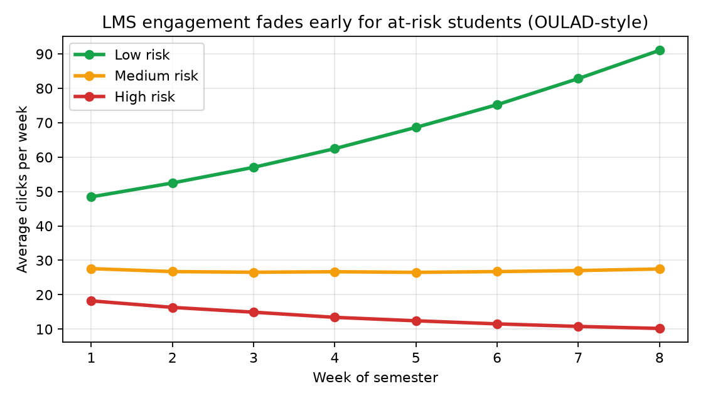
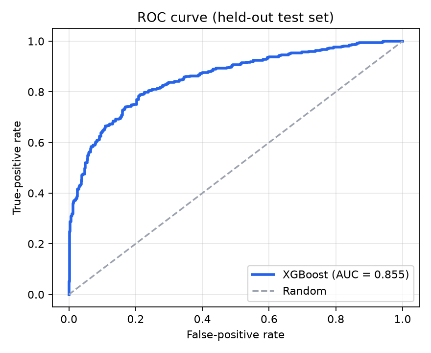
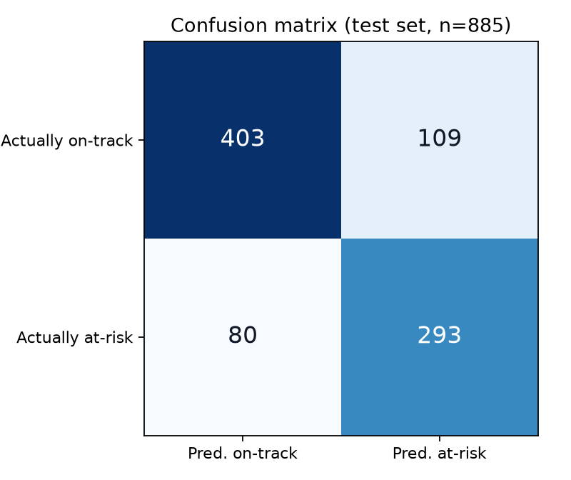
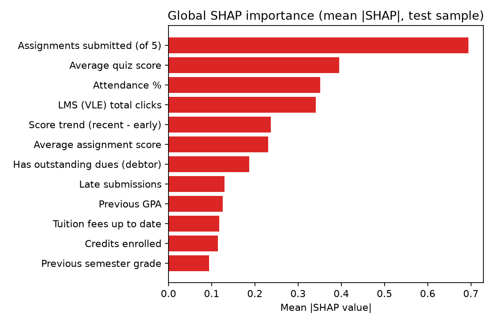
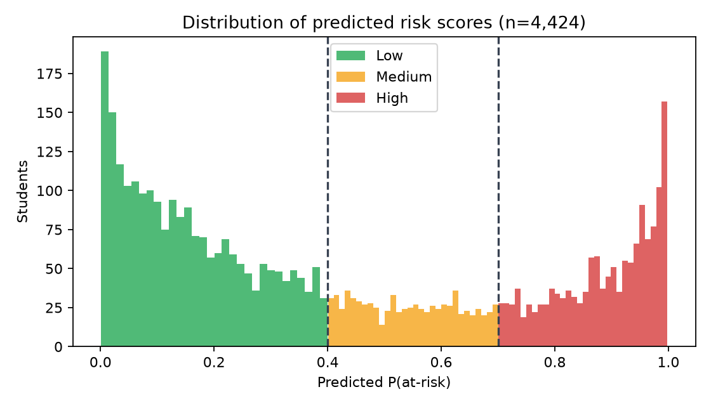
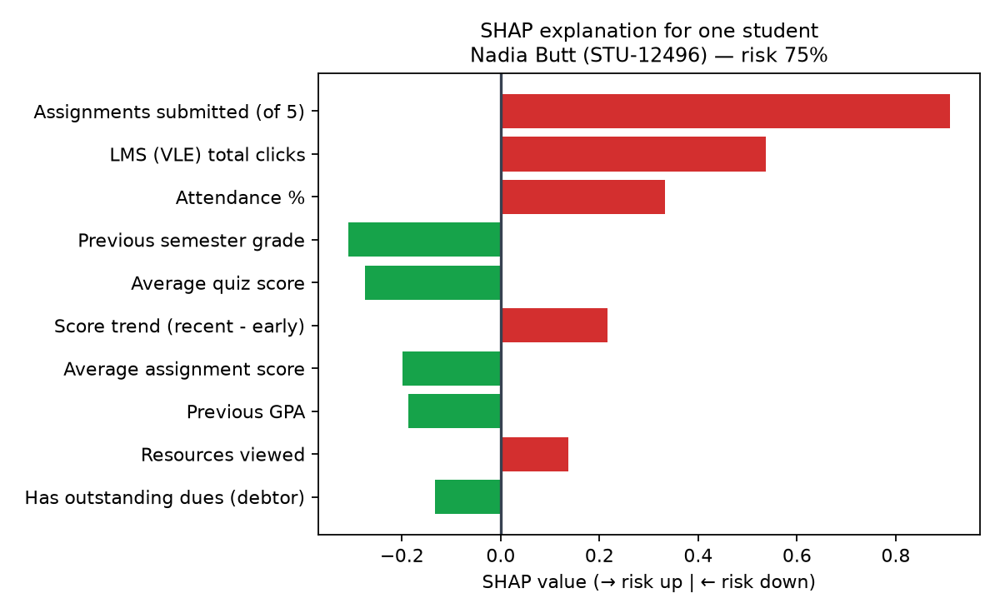

# Student Early-Warning System
## Predicting At-Risk Students Early in the Semester using OULAD (#99) and UCI Student Dropout (#100), with SHAP Explanations and What-If Simulation

**Project type:** Applied Machine Learning / Learning Analytics — Priority Research Portal Project (#99 + #100 combined)
**Deliverable:** Working three-portal web application (Admin · Teacher/Advisor · Student) + reproducible ML pipeline
**Stack:** Python, scikit-learn, XGBoost, SHAP, Streamlit, Plotly, SQLite

---

## Abstract

Universities typically identify a struggling student only after failure or withdrawal, when intervention is
no longer possible. This project builds an **early-warning system** that predicts, by **week 8** of a semester,
which students are at risk of failing or withdrawing, using features drawn from two well-known public datasets:
**OULAD** (Open University Learning Analytics Dataset — week-by-week Virtual Learning Environment activity and
assessments for 32,593 students) and the **UCI Student Dropout and Academic Success** dataset (academic,
demographic and financial features for 4,424 students). An **XGBoost** classifier trained on a unified
OULAD+UCI schema (n = 4,424) achieves **78.6% accuracy, 78.6% recall and 0.855 ROC-AUC** on a held-out test
set — comparable to Random Forest and Logistic Regression baselines. The system's main contribution is not the
score itself but what surrounds it: (i) **SHAP explanations translated into plain English** for every individual
student ("flagged *because* only 3 of 5 assignments were submitted and LMS activity is very low"), (ii) a
**what-if simulator** that re-scores students under hypothetical behaviour changes (e.g. risk **75% → 11%**
under a combined, realistic action plan), and (iii) a **closed intervention loop** across three role-based
portals — Admin, Teacher/Advisor, and the Student's own supportive "my record" view. Demographic attributes
(age, gender) are deliberately excluded from model inputs as a fairness measure. The system is designed as
decision *support* for human advisors, not as an automated labelling or punishment mechanism.

**Keywords:** learning analytics, early warning system, student dropout, OULAD, XGBoost, SHAP, explainable AI, counterfactual what-if

---

## 1. Introduction

### 1.1 Problem
Student failure and dropout are usually *visible in behaviour weeks before they are visible in grades*:
declining LMS logins, missed or late assignments, falling quiz scores, and dropping attendance all precede
the final outcome. Yet in most institutions the first formal signal is the failed exam itself. Advisors cannot
manually monitor hundreds of students' week-by-week traces, so struggling students are discovered too late.

### 1.2 Aim and objectives
**Aim:** flag at-risk students early enough (by week 8) that a human intervention can still change the outcome.

1. Combine the complementary strengths of OULAD (behavioural/engagement signals over time) and the UCI
   Dropout dataset (prior academic record and financial context) into one predictive schema.
2. Train and honestly compare candidate classifiers (XGBoost, Random Forest, Logistic Regression) with
   metrics appropriate to the domain (recall and ROC-AUC emphasised over raw accuracy).
3. Make every prediction **explainable** with SHAP, expressed in natural language at the level of an
   individual student.
4. Support **action**, not just prediction: a what-if simulator and a teacher→student intervention workflow.
5. Deliver role-appropriate interfaces for **Admin**, **Teacher/Advisor**, and **Student** users, with
   fairness and supportive framing built in by design.

### 1.3 Why this combination is interesting
Neither dataset alone tells the full story. OULAD knows *how a student is behaving now* but little about
financial pressure; the UCI data knows *context and history* but nothing about week-by-week engagement.
An early-warning system in a real university would draw on both kinds of source (LMS logs + student
information system), which is exactly the architecture implemented here.

---

## 2. Related work and datasets

**OULAD** (Kuzilek, Hlosta & Herrmannova, 2017) contains 32,593 students across 7 modules (22 presentations),
with demographic data, assessment submissions and scores, and a clickstream of ≈10.6M VLE interactions.
Its `final_result` takes values *Pass / Distinction / Fail / Withdrawn*. A consistent finding in the
literature built on OULAD is that VLE activity in the first weeks is among the strongest predictors of
the final result, and that engagement of eventually-failing students diverges early.

**UCI "Predict Students' Dropout and Academic Success"** (Realinho et al., 2022; Polytechnic Institute of
Portalegre) contains 4,424 students with 36 features covering application/admission data, prior qualifications,
curricular units credited/enrolled/approved and grades per semester, and socio-economic/financial attributes
(scholarship holder, debtor, tuition fees up to date, parents' qualifications/occupation), with target
*Graduate / Enrolled / Dropout*.

**Explainability.** Black-box risk scores are poorly trusted by advisors and can feel like surveillance to
students. SHAP (Lundberg & Lee, 2017) provides theoretically grounded, per-prediction feature attributions;
for tree ensembles the TreeExplainer computes them exactly and efficiently. This project adds a
natural-language layer on top of SHAP and pairs explanations with *counterfactual* what-if re-scoring,
so an explanation always comes with a suggested direction of improvement.

---

## 3. Data and methodology

### 3.1 Unified schema and the "week-8 rule" (leakage control)
The single most important methodological decision is temporal: **every model feature must be knowable by
week 8 of the semester.** End-of-semester marks or the final result are never inputs — using them would be
target leakage and would produce a useless "predictor" that only works after the outcome is already known.
The target is binary: `at_risk = 1` iff the student's recorded final result is *Fail* or *Withdrawn*
(OULAD framing; equivalently *Dropout* in UCI framing).

| Feature (21 used) | Source | Type |
|---|---|---|
| first_generation, scholarship_holder, debtor, tuition_up_to_date | UCI | binary |
| admission_grade, prev_gpa, credits_enrolled, credits_approved_prev_sem, prev_sem_grade | UCI | numeric |
| attendance_pct | institutional | numeric |
| vle_total_clicks, vle_active_days, forum_posts, resources_viewed, quiz_attempts | OULAD (studentVle) | numeric |
| avg_quiz_score, assignments_submitted (of 5), late_submissions, missing_submissions, avg_assignment_score, score_trend | OULAD (assessments) | numeric |

Weekly clicks `w1_clicks … w8_clicks` are retained for visualisation (engagement trajectories), while the
model consumes their week-8 aggregates. `age` and `gender` are present in the raw data but are
**excluded from model inputs by design** (see §6 Ethics) — this is enforced in `config.FEATURES` and by a
unit test (`test_no_demographic_features_in_model`).

### 3.2 Dataset construction
The two source datasets describe different institutions' students and therefore cannot be merged row-wise.
Following standard practice for combined #99+#100 projects, `src/generate_data.py` generates a dataset **in
the unified schema** (n = 4,424, mirroring UCI's size; 8 courses, 8 teachers) using latent factors —
*ability*, *engagement* and *financial stress* — so that correlations between LMS activity, submissions,
scores, finances and the outcome are statistically consistent rather than independent noise. The outcome is
sampled from the *realised* features (including non-linear threshold/interaction effects, e.g. risk spikes
when low clicks coincide with falling scores) plus noise, so the learner must genuinely re-discover the
pattern. Resulting label balance: **42.2% at-risk** (Pass 48.6%, Fail 25.9%, Withdrawn 16.3%, Distinction 9.2%),
in line with OULAD's Fail+Withdrawn share. The generator also documents how to substitute the genuine
datasets (§3.3); the rest of the pipeline is schema-driven and unchanged.

### 3.3 Substituting the real datasets
- **UCI:** `pip install ucimlrepo`; `generate_data.download_uci()` fetches *Predict Students Dropout and
  Academic Success* to `data/uci_real_raw.csv`.
- **OULAD:** from analyse.kmi.open.ac.uk — aggregate `studentVle.csv` clicks into weeks 1–8 per student,
  derive submission/lateness/score features from `studentAssessment.csv` + `assessments.csv` up to week 8,
  take `final_result` from `studentInfo.csv` as the target, map columns to `config.FEATURES`, save as
  `data/students_raw.csv`, then retrain (CLI or Admin → Model Center → Retrain).

### 3.4 Models and evaluation protocol
- **Split:** stratified 80/20 train/test (3,539 / 885), `random_state=42`; identical split for all models.
- **Candidates:** XGBoost (250 trees, depth 4, lr 0.05, `scale_pos_weight` for class balance);
  Random Forest (300 trees, balanced); Logistic Regression (standardised, balanced) as an interpretable baseline.
- **Metrics:** Accuracy, Precision, Recall, F1, ROC-AUC, confusion matrix, ROC curve.
  **Recall is prioritised**: a false negative (a truly at-risk student whom nobody contacts) is far more
  costly than a false positive (a check-in email to a student who turns out fine).
- **Risk bands for triage:** Low < 40% ≤ Medium < 70% ≤ High — deliberately inclusive at the Medium band so
  borderline students are *monitored*, not ignored.
- **Explanations:** SHAP TreeExplainer (exact for XGBoost); global importance = mean |SHAP| over a test
  sample; per-student values translated to sentences by a template layer in `src/predict.py`.
- **What-if:** counterfactual re-scoring — copy the student's feature vector, apply user-controlled
  changes, keep derived quantities consistent (e.g. submitted = 5 − missing), and re-predict.

---

## 4. Exploratory findings (`analysis/eda.py`)

Students who finish *Fail/Withdrawn* already differ markedly by week 8 from those who pass:

| Week-8 signal (mean) | On-track | At-risk |
|---|---|---|
| LMS total clicks | 472 | **165** |
| LMS active days | 35.7 | **16.1** |
| Quiz average | 68.8% | 53.1% |
| Assignment average | 69.7% | 54.4% |
| Attendance | 80.7% | 66.2% |
| Missing assignments (of 5) | 0.7 | **2.1** |
| Score trend (recent − early) | −3.6 | **−11.4** |
| Previous GPA | 2.9 | 2.4 |



The engagement curves separate from week 1 and widen every week — the empirical justification for an
*early* warning system. Financial features also carry signal: students who are both debtors and behind on
tuition show a 62.7% at-risk rate vs 36.0% for students with fees up to date, which is why the intervention
menu includes a **finance-office referral**, not only academic help. Strongest raw correlations with
`at_risk`: missing submissions (+0.52), attendance (−0.51), LMS active days (−0.51), assignment score (−0.46),
quiz score (−0.46).

---

## 5. System design and implementation

### 5.1 Architecture
```
data/students_raw.csv ─► src/train_model.py ─► models/model.pkl + metrics.json
        (LMS/SIS extracts      XGBoost/RF/LR,        data/students_scored.csv
         in unified schema)    SHAP global          (every student pre-scored)
                                        │
app.py (Streamlit) ─ login ─► role routing
   ├─ src/views/admin_view.py     Admin panel
   ├─ src/views/teacher_view.py   Teacher/advisor portal      ─► src/predict.py
   └─ src/views/student_view.py   Student portal                  (predict + SHAP
   └─ src/views/common.py         shared detail/what-if UI        + what_if engine)
src/database.py ─ SQLite (data/app.db): users + interventions
```
Batch scoring at train time keeps dashboards instant; SHAP is computed on demand for the single student
being viewed (<0.1 s), and what-if re-scoring is a single model call per slider change.

### 5.2 Database (application side; academic records remain in the scored CSV, mirroring SIS/LMS extracts)
- `users(id, username UNIQUE, password_hash, role ∈ {admin, teacher, student}, full_name, email,
  linked_student_id, linked_teacher_id, is_active, created_at)` — passwords stored as salted SHA-256 hashes.
- `interventions(id, student_id, student_name, teacher_name, kind, note, status, risk_at_time, created_at)`.

`linked_*` columns are what make the portals personal: a teacher login maps to a teacher/cohort, a student
login maps to exactly one student record ("my record"). The seeder creates 1 admin, 8 teachers and a
demo sample of student logins (username = student ID); Admins can create/deactivate/delete further accounts
in-app, and adding a student in the Admin panel can auto-create their login.

### 5.3 Roles and functionality
**Admin** — institution KPIs; risk by course; engagement-fade insight chart; student registry with
course/teacher/risk filters, search, CSV export and full per-student inspection; add-student form with
instant scoring; batch CSV scoring with downloadable template; user & teacher management (cohort sizes,
high-risk counts, interventions per teacher); **Model Center** (model comparison, confusion matrix, ROC,
global SHAP, one-click retraining); oversight of all interventions.

**Teacher/Advisor** — cohort dashboard; prioritised at-risk queue; **Student Explorer**: risk gauge,
plain-English SHAP reasons + SHAP bar chart, weekly LMS activity vs class and on-track averages,
assignment-level table, what-if simulator with preset scenarios, full feature record vs class average,
intervention logger (note pre-filled from the student's top SHAP reason) and per-student history;
class analytics; intervention status management.

**Student** — a deliberately supportive presentation of the same engine: **Success Score (100 − risk%)**,
status message, headline metrics vs class, complete own record (profile, assignments, engagement, weekly
table), *"Why my score?"* with friendly reasons and concrete advice per reason (technical SHAP chart
available under an expander — transparency in both directions), personal what-if action-plan sliders with
a commitment checklist, and **Messages from Teacher** (the interventions logged for them).

### 5.4 Testing
`tests/test_system.py` (stdlib `unittest`, 10 tests, all passing) covers: risk-band boundaries; dataset
completeness (no missing feature values); scores being valid probabilities; exclusion of age/gender from
model inputs; SHAP output shape/sign conventions; **what-if monotonicity** (fixing submissions/engagement
must lower a recoverable high-risk student's score); submission-arithmetic consistency in what-if; and
authentication for all three roles incl. wrong-password rejection. In addition, every one of the 14 portal
pages was exercised headlessly with Streamlit's `AppTest` (0 exceptions).

---

## 6. Results

### 6.1 Model comparison (held-out test set, n = 885)

| Model | Accuracy | Precision | Recall | F1 | ROC-AUC |
|---|---|---|---|---|---|
| **XGBoost (deployed)** | **0.786** | 0.729 | **0.786** | **0.756** | 0.855 |
| Random Forest | 0.786 | 0.736 | 0.769 | 0.752 | 0.859 |
| Logistic Regression | 0.770 | 0.703 | 0.786 | 0.742 | 0.857 |

The three models are statistically close (ΔAUC ≈ 0.004). XGBoost is deployed for two stated reasons:
(1) exact, fast SHAP values via TreeExplainer for per-student explanation; (2) native handling of the
non-linear threshold effects that characterise real OULAD behaviour (e.g. "≥2 missing assignments").

Confusion matrix (XGBoost, threshold 0.5): TN = 403, FP = 109, **FN = 80**, TP = 293.
Interpretation: of 373 truly at-risk test students, 293 (78.6%) are flagged in time; 80 are missed —
the number the Medium band and weekly re-scoring (future work) are designed to shrink. The 109 false
alarms each cost one supportive check-in, an acceptable operational price.

|  |  |
|---|---|

### 6.2 What drives risk? Global SHAP


The dominant drivers — **assignments submitted (0.69), quiz average (0.40), attendance (0.35), LMS clicks
(0.34), score trend (0.24), assignment average (0.23)** — are all *modifiable behaviours observable by
week 8*, while background/financial variables contribute smaller but real effects (debtor 0.19,
tuition 0.12). Institutional distribution of scores: **Low 50.2% · Medium 17.5% · High 32.3%** of students.



### 6.3 Case study: one student, end to end


**Nadia (STU-12496, PHY101) — predicted risk 75% (High).** SHAP shows a *disengagement* profile rather
than an *ability* profile: only 3 of 5 assignments submitted (+0.91), 70 LMS clicks (+0.54), 64%
attendance (+0.33), scores falling by 14 points (+0.22), while a **78% quiz average (−0.28)** and strong
previous-semester grade (−0.31) pull risk down. What-if re-scoring quantifies the advising conversation:
quiz +10 points alone → **64%**; submitting everything on time → **28%**; a combined realistic plan
(+15 quiz, +10 assignment average, no missing/late, +200 clicks, +15 attendance) → **11% (Low)**.
The teacher then logs a meeting intervention (auto-drafted from the top reason), which appears verbatim
in Nadia Student portal under *Messages from Teacher*, alongside her own action-plan view of the same numbers.

---

## 7. Ethics, fairness and responsible use

- **No demographic inputs.** Age and gender are excluded from `FEATURES`: students must be flagged for
  *changeable* behaviour and circumstances an advisor can act on, never for who they are. First-generation
  status is retained only as *support context* (its global SHAP weight is small, 0.05) and is never
  presented punitively.
- **Support, not surveillance.** The student-facing framing is a Success Score with advice; there is no
  "predicted to fail" label in the Student portal, and scores are described as early estimates, not grades.
- **Transparency & contestability.** Students can see their complete record, the same SHAP chart their
  teacher sees, and are told how to get incorrect data corrected.
- **Human in the loop.** The system prioritises outreach; no automated penalty, enrolment or grading
  decision is taken from the score. Interventions are supportive (meetings, tutoring, finance referral).
- **Privacy.** Demo passwords aside, credentials are hashed, roles restrict visibility (students see only
  themselves; teachers default to their own cohort), and no real student data ship with this repository.
- **Known bias risks** (to state honestly): LMS-click features can disadvantage students with poor
  connectivity or who study offline; financial features must trigger *support referrals*, never stigma.
  Any real deployment should audit error rates across student groups before use.

---

## 8. Limitations

1. **Simulated combined data.** Because OULAD and UCI cannot be row-merged, the distributed dataset is
   generated in the unified schema (§3.2). Absolute metrics therefore demonstrate the pipeline rather
   than constituting a benchmark on the original populations; §3.3 documents the swap to real extracts.
2. **Single snapshot.** The model scores at week 8 only; it does not yet exploit the full weekly sequence
   (e.g. trajectory shape) beyond aggregates and trend. The ~100% cases also show limited what-if
   movement — behaviour change that extreme needs human, not slider, intervention.
3. **Probabilities are ranking signals.** XGBoost scores are not perfectly calibrated probabilities;
   they are used for triage bands, and calibration (Platt/isotonic) is listed as future work.
4. **Intervention effectiveness is not yet measured.** The system logs help given but cannot yet claim
   causally that interventions *caused* recoveries (that needs longitudinal follow-up / uplift modelling).
5. **Assignments detail table** in the portals is deterministically derived from summary submission fields
   for display; a production system would read it directly from the LMS gradebook.

## 9. Future work
Weekly re-scoring (separate week-2/4/6/8 models) to catch late disengagers and reduce false negatives;
training on genuine OULAD extracts and cross-institution validation; probability calibration and
fairness audits by subgroup; automated (human-approved) alerts when a student crosses into High;
sequence models (e.g. LSTM/Temporal CNN over weekly clicks) compared against the aggregate baseline;
Moodle/LMS API and SIS integration; and an intervention-effectiveness study comparing outcomes of
flagged-and-supported vs flagged-only students.

## 10. Conclusion
The project demonstrates a complete, working early-warning *system* rather than a standalone classifier:
a leakage-safe week-8 feature schema fusing OULAD engagement with UCI academic/financial context, an
honestly-benchmarked XGBoost model (78.6% recall, 0.855 AUC), per-student SHAP explanations in plain
English, counterfactual what-if planning, and a three-role application that closes the loop from
prediction → explanation → conversation → logged, visible support. Its design choices — recall over
accuracy, behaviour over demographics, success-framing for students — are as much the contribution as
the model itself, and each is implemented, tested and demonstrable in the running application.

---

## References
1. Herrmannova, D., Zdrahal, Z. (2017). "Open University Learning Analytics dataset."
   *Scientific Data* 4, 170171. https://analyse.kmi.open.ac.uk/open_dataset
2. Realinho, V., Vieira Martins, M., Machado, J., Baptista, L. (2022). "Predict Students' Dropout and
   Academic Success." UCI Machine Learning Repository. https://archive.ics.uci.edu/dataset/697
3. Chen, T., Guestrin, C. (2016). "XGBoost: A Scalable Tree Boosting System." *Proc. KDD '16*.
4. Lundberg, S., Lee, S.-I. (2017). "A Unified Approach to Interpreting Model Predictions." *NeurIPS 30*.
5. Lundberg, S. et al. (2020). "From local explanations to global understanding with explainable AI for trees." *Nature Machine Intelligence* 2.
6. Hlosta, M., Zdrahal, Z., Zendulka, J. (2017). "Ouroboros: early identification of at-risk students…" *Proc. KDD ML4ED / LAK-related works on OU Analyse.*
7. Pedregosa et al. (2011). "Scikit-learn: Machine Learning in Python." *JMLR* 12.

---

## Appendix A — Reproduction
```bash
pip install -r requirements.txt
python -m src.generate_data     # data/students_raw.csv (4,424 × unified schema)
python -m src.train_model       # models/model.pkl, metrics.json, students_scored.csv
python -m src.database          # data/app.db (admin/teacher/student logins)
python analysis/eda.py          # §4 findings        |  python -m src.make_figures  # figures (matplotlib)
python -m unittest discover -s tests -v             # 10 tests
streamlit run app.py            # http://localhost:8501
```
Demo logins: `admin/admin123` · `sarah.ahmed/teacher123` · `demo.student/student123` (Nadia Butt case study)
· any seeded student via their ID, e.g. `stu-10001/student123`.

## Appendix B — Anticipated viva questions
**Why not accuracy as the headline metric?** Classes are imbalanced and errors are asymmetric: a missed
at-risk student (FN) may withdraw unsupported, while a false alarm costs one friendly email. Hence recall,
ROC-AUC and the confusion matrix lead, and triage bands start "Medium" at 40%.

**Where could leakage hide, and how did you prevent it?** Using end-of-semester grades/results, or
aggregating clicks over the *whole* semester. All features are week ≤ 8 by construction (§3.1); the target
is the only end-of-semester quantity.

**Why XGBoost if Random Forest's AUC is 0.004 higher?** The difference is within noise; XGBoost gives
*exact* SHAP TreeExplainer attributions (required for trustworthy per-student explanations), the best
F1/recall balance here, and handles threshold interactions typical of real OULAD data.

**SHAP vs feature importance?** Global importance says what matters *on average*; SHAP says what drove
*this* student's score, with direction — e.g. Nadia's strong quizzes actively pull her risk down even
though she is High overall. Advisors act on individuals, so local explanation is the useful one.

**Is the what-if causal?** No — it is a model counterfactual ("if this student's recorded features looked
like *that*, the model would say *this*"), valuable for planning and motivation, and presented as such.
Causal claims would require intervention studies (future work).

**Why exclude gender/age if the datasets provide them?** Fairness and actionability: they cannot be
changed by the student or advisor, and flagging on demographics risks discriminatory labelling for
negligible predictive gain (their importances were the lowest observed).

**How would this run in a real university?** Nightly LMS (Moodle) + SIS extracts → unified schema →
re-score → advisor queues update. The code seam is exactly there: replace `students_raw.csv` and retrain.

**What if a student games LMS clicks?** Clicks are one of 21 features and interact with scores/submissions;
click-inflation without submissions barely moves the score — visible in the what-if presets. Human review
remains the safeguard.

## Appendix C — Feature dictionary
See `config.py` (`FEATURES`, `FEATURE_LABELS`) — the single source of truth shared by the generator,
trainer, explanation engine and all three portals; §3.1's table lists each feature with its dataset of origin.
